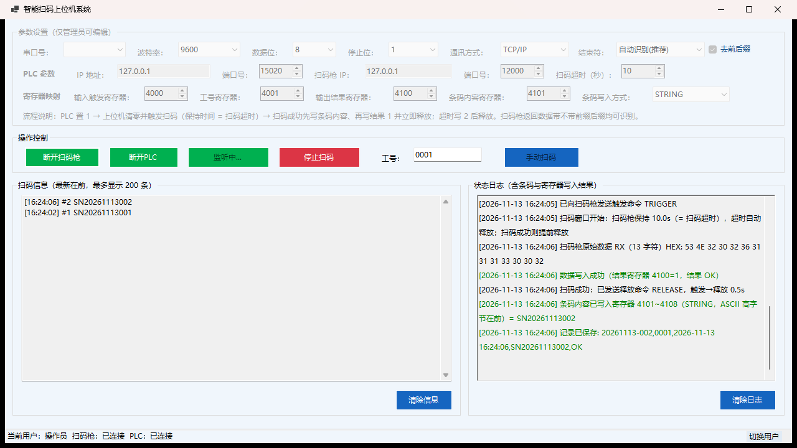

# SmartScanner 智能扫码上位机系统

面向产线工位的扫码采集与 PLC 联动上位机（C# WinForms / .NET 10）。
上位机作为 TCP 客户端（或串口主站）连接扫码枪，按 PLC 的触发信号控制扫码枪的**触发与释放**，
把条码内容与结果（OK/NG）写回 PLC 保持寄存器，并生成本地扫码记录。



> 截图取自演示环境：PLC 与扫码枪均为本机模拟服务，条码为示例数据。

> **说明**：本项目由 AI Agent 辅助开发，已在汇川 PLC + 斯普锐扫码枪上完成现场检验，**仅供学习与工程参考**，使用前请阅读文末[免责声明](#免责声明)。

## 下载

- 最新发布包：[Releases](https://github.com/YinFengLLL/SmartScanner/releases/latest) —— `SmartScanner-win-x64-20261113.zip`
- 解压后直接运行 `SmartScanner.App.exe`（win-x64 单文件自包含，无需安装 .NET 运行时），同目录保留 `config.json`

## 已测硬件（现场验证）

| 角色 | 型号 / 环境 | 说明 |
| --- | --- | --- |
| PLC | **汇川（Inovance）PLC** | Modbus TCP 从站，保持寄存器读写（FC3 / FC6 / FC16） |
| 扫码枪 | **斯普锐（Superscan）C20DE-RF10** | TCP Server 模式，命令触发 `TRIGGER` / `RELEASE`，返回数据可带前缀后缀也可不带 |
| 上位机 | Windows 10 / 11 x64 | .NET 10 单文件发布，无需安装运行时 |

> 本项目已在上述硬件组合上完成**现场检验**（触发握手、扫码测试、结果回写、异常断线与长时间运行）。
> 其它品牌 PLC（只要支持标准 Modbus TCP）与串口扫码枪理论上可用，但未逐一实测，寄存器地址需按现场 PLC 程序调整。

## 开发方式

本项目使用 **AI Agent（智能体）辅助开发**：需求梳理、代码实现、单元测试与文档由 Agent 完成，
关键逻辑（PLC 握手、扫码时序、扫码枪收帧）由人工复核，并在现场反复调试确认后才定稿。
因此代码与文档可能带有 AI 生成痕迹，欢迎通过 Issue / PR 指正；生产使用前请务必自行评审。

## 功能

- **扫码枪通讯**：TCP/IP CLIENT（扫码枪侧为 TCP Server）与串口（USB COM）双模式
- **扫码内容前后缀可配置**：自动识别 / CRLF / CR / LF / 无前后缀；扫码枪返回信息不带前后缀时按静默 150ms 分帧，无需给扫码枪加后缀
- **PLC 交互**（Modbus TCP 保持寄存器）：输入触发 4000 / 工号 4001 / 输出结果 4100 / 条码内容 4101
- **扫码时序（扫码窗口）**：PLC 触发 → 上位机发 `TRIGGER`，扫码枪保持 `扫码超时` 秒；扫码成功立即 `RELEASE`（提前释放），超时先写结果 2 再 `RELEASE`
- **条码写入方式**：INT16（1 个寄存器）/ INT32（2 个寄存器，高字在前）/ STRING（多寄存器 ASCII，高字节在前）
- **开机自动启动**：打开软件自动连接 PLC、连接扫码枪并进入触发监听；只监听、不主动触发（启动时清零残留触发信号）
- **本地记录**：`Data\YYYYMMDD.txt`（编号,工号,时间,条码,结果），先落盘不阻塞通讯
- **权限**：操作员 / 管理员两种角色，仅管理员可改参数（默认密码见 `AuthService`，上线请修改）
- **配置记忆**：`config.json` 修改即存、启动加载
- **现场诊断日志**：扫码枪原始数据 RX（HEX）、触发→释放耗时、寄存器写入结果

## 寄存器与握手约定

| 寄存器 | 默认地址 | 方向 | 说明 |
| --- | --- | --- | --- |
| 输入触发 | 4000 | PLC → 上位机 | PLC 写 1 触发一次扫码；上位机读到 1 后写 0 应答（脉冲触发） |
| 工号 | 4001 | PLC → 上位机 | 工号数值，读 0 时回退界面工号（默认 0001） |
| 输出结果 | 4100 | 上位机 → PLC | 1 = OK（已获取条码）/ 2 = NG（扫码超时） |
| 条码内容 | 4101 | 上位机 → PLC | 按写入方式写入条码内容，先写内容再写结果 |

> 触发寄存器请用**脉冲**方式：置 1 后由上位机清零应答；不要长期保持 1，否则每次复位后都会被当作新的触发。

## 结构

```
src/SmartScanner.Core   通讯与业务层（扫码枪 TCP/串口、Modbus TCP、触发监听、权限、日志）
src/SmartScanner.App    WinForms 主界面
tests/SmartScanner.Core.Tests   单元与集成测试（本地 Modbus 从站 + 模拟扫码枪）
```

## 构建与运行

```bash
dotnet build SmartScanner.slnx
dotnet test SmartScanner.slnx

# 发布单文件（win-x64，自包含）
dotnet publish src/SmartScanner.App/SmartScanner.App.csproj -c Release -r win-x64 \
  --self-contained true -p:PublishSingleFile=true \
  -p:IncludeNativeLibrariesForSelfExtract=true -o publish
```

运行目录只需 `SmartScanner.App.exe` + `config.json`（+ 运行后自动生成的 `Data` 目录）。

## 现场配置要点

- **通讯方式**：TCP/IP（填扫码枪 IP 与端口）或串口（COM 口/波特率）
- **结束符**：默认「自动识别(推荐)」，扫码枪有无前后缀都能识别；修改「结束符 / 去前后缀」后需重新连接扫码枪生效
- **扫码超时**：即触发后扫码枪保持工作的时间，也是「触发→释放」的最大间隔
- **条码写入方式**：条码位数较多（如 13 位数字超过 65535）时必须选 DINT(32位) 或 STRING，否则内容寄存器写不进去
- **排查数据通道**：日志出现 `扫码枪原始数据 RX ... HEX:` 说明已收到扫码枪数据；若一直不出现，先查网络/端口/线序

## 免责声明

1. 本项目为**学习与工程参考项目**，按「现状」（AS IS）提供，不附带任何明示或暗示的担保，包括但不限于适销性、特定用途适用性与无侵权担保。
2. 项目虽已在现场环境（汇川 PLC + 斯普锐扫码枪）完成验证，但**不同 PLC 型号、寄存器映射、扫码枪固件、现场网络与工艺流程都可能造成行为差异**。投入生产前请自行完成完整测试与验收，作者不对现场适配结果负责。
3. **严禁用于安全相关回路**：涉及人身安全、急停、安全联锁、危险机械动作的场景，必须由具备资质的工程师按相关标准独立设计与验证，本软件不得作为安全控制手段。
4. 使用或无法使用本项目造成的任何直接或间接损失（包括但不限于生产中断、产品报废、数据丢失、设备损坏、人身伤害、利润损失），作者不承担任何责任。
5. PLC 寄存器写入与设备动作具有风险，请先在**空载 / 断开执行机构**的条件下联调；上线前请修改默认管理员密码，并按现场规范设置网络隔离与访问控制。
6. 仓库中的 IP、寄存器地址、默认密码、条码等均为示例或默认值，不代表任何真实产线配置。
7. **下载、复制或使用本项目即视为已阅读并同意以上条款**；如不同意，请勿使用。

## 更新日志

### 2026-11-13
- 新增：开始扫码 / 开机自启只进入监听，不再主动触发；启动时清零残留触发信号（修复「按下就开始扫」）
- 新增：开机自动连接 PLC、扫码枪并开始扫码监听；退出时释放扫码枪
- 新增：扫码内容前后缀（结束符）可配置，无前后缀扫码枪按静默 150ms 分帧（修复「有数据但判失败」）
- 新增：扫码枪原始数据 RX（HEX）日志，便于现场确认数据通道
- 修改：释放命令改为按扫码窗口（= 扫码超时）执行，扫码成功提前释放；释放幂等、只发一次
- 修改：通讯方式按上次保存的配置恢复（原来固定使用 TCP 通道）
- 修复：扫码枪命令回显被误判为扫码成功
- 测试：新增时序、前后缀、残留触发等用例，共 59 个测试
- 文档：补充已测硬件（汇川 PLC + 斯普锐扫码枪）、AI Agent 辅助开发方式与免责声明

### 2026-08-10
- 源码备份快照（扫码枪串口/TCP 双模式 + PLC 触发握手 + 权限）
